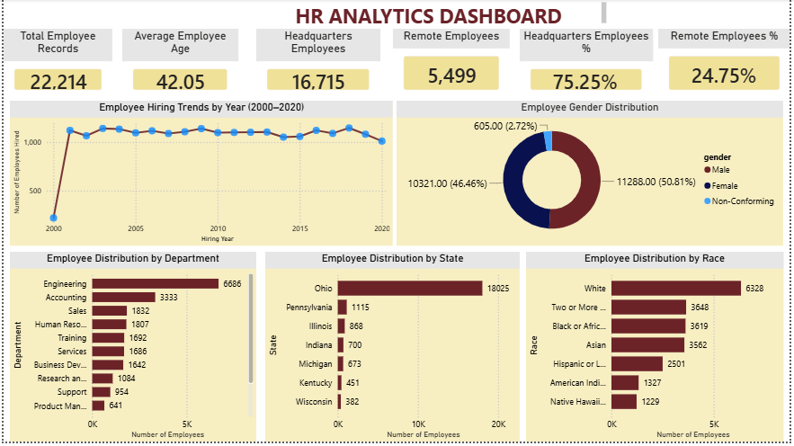
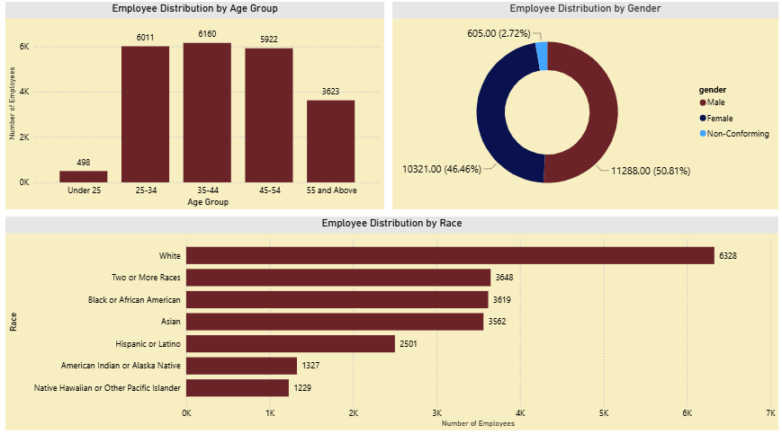
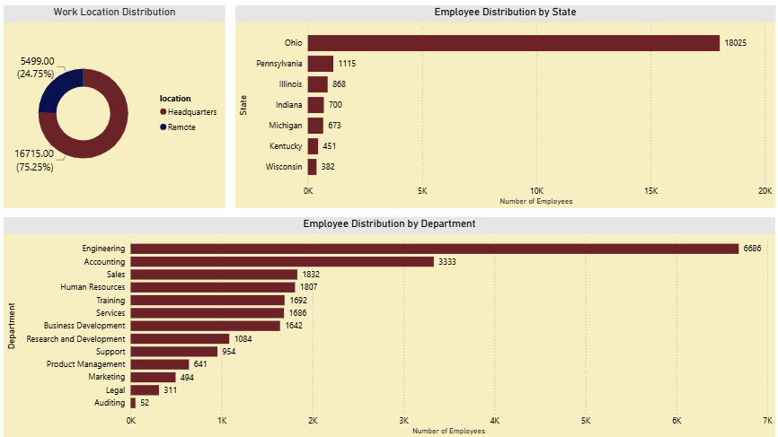
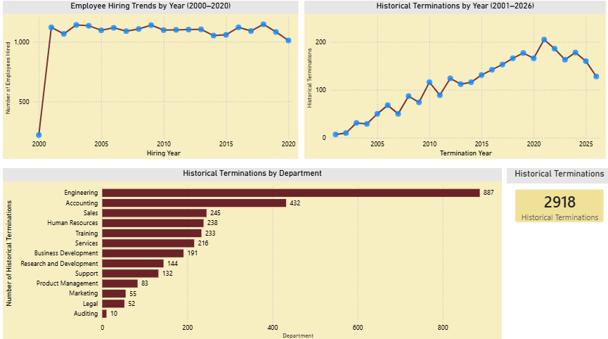

# HR Analytics Project

## Project Overview
The HR Analytics project focuses on analyzing employee data to understand workforce demographics, employee distribution, hiring trends, work locations, termination patterns and tenure.

The objective is to generate meaningful insights and provide data-driven recommendations to support HR decision-making.

## Tools & Technologies
- MySQL 5.7
- MySQL Workbench
- SQL
- Power BI
- ODBC

## Dataset Overview
- Total Records: 22,214
- Total Columns: 14
- Departments: 13
- States: 7

The dataset contains employee information including age, gender, race, department, job title, work location, hire date, termination date, city and state.

## Project Objectives
1. Analyze total employee records and average employee age.
2. Calculate headquarters and remote workforce percentages.
3. Analyze hiring trends by year.
4. Understand employee distribution by gender and race.
5. Analyze employee distribution by state and department.
6. Examine historical termination patterns.
7. Analyze employee age and tenure.
8. Provide actionable HR recommendations.

## Key Performance Indicators

| KPI | Result |
|---|---:|
| Total Employee Records | 22,214 |
| Average Corrected Age | 42.05 years |
| Headquarters Employees | 16,715 |
| Remote Employees | 5,499 |
| Headquarters Percentage | 75.25% |
| Remote Percentage | 24.75% |
| Historical Terminations | 2,918 |

## Key Findings
- Engineering is the largest department with 6,686 employee records.
- Ohio accounts for 81.14% of employee records.
- Male employees represent 50.81% of records.
- The average corrected employee age is 42.05 years.
- The highest hiring count in the available annual data occurred in 2018.
- Historical terminations peaked in 2021, with 205 records.
- Average completed service before historical termination is 8.51 years.

## Statistical Analysis
The project includes:
- Mean and Median
- Population Standard Deviation
- Quartiles and Interquartile Range (IQR)
- Percentage Distribution
- Employee Age Analysis
- Employee Tenure Analysis

## Power BI Dashboard

The dashboard contains four report pages:

1. HR Overview
2. Employee Demographics
3. Workforce Distribution
4. Hiring & Retention

### Dashboard Screenshots

**HR Overview**



**Employee Demographics**



**Workforce Distribution**



**Hiring & Retention**



## Repository Structure

```text
HR-Analytics-Project/
│
├── SQL/
│   └── HR_Analytics_Analysis.sql
│
├── PowerBI/
│   ├── HR Analytics.pbix
│   └── Dashboard_Screenshots/
│       ├── HR_Overview.png
│       ├── Employee_Demographics.png
│       ├── Workforce_Distribution.png
│       └── Hiring_Retention.png
│
├── Charts/
│   └── HR Analytics Visualization PNG files
│
├── Reports/
│   └── HR_Analytics_Analysis_Report.pdf
│
├── Presentation/
│   └── HR_Analytics_Project_Presentation.pptx
│
└── README.md
```

## Recommendations
- Review workforce planning in larger departments.
- Evaluate the headquarters and remote workforce distribution.
- Investigate future-dated termination records.
- Monitor hiring and historical termination trends.
- Use age and tenure analysis to support workforce development and succession planning.

## Limitations
- Blank termination dates are not independently verified as active employment.
- Future-dated termination values require validation.
- 2026 termination data is partial.
- Historical termination counts should not be interpreted as annual turnover rates.
- Potential tenure is not completed service for employees who have historically left.

## Conclusion
This project demonstrates the application of SQL, statistical analysis and Power BI to transform HR data into meaningful workforce insights. The findings and recommendations support more informed HR planning and decision-making.

**Project Type:** Data Analytics  
**Tools:** SQL | MySQL | Power BI | Statistics
